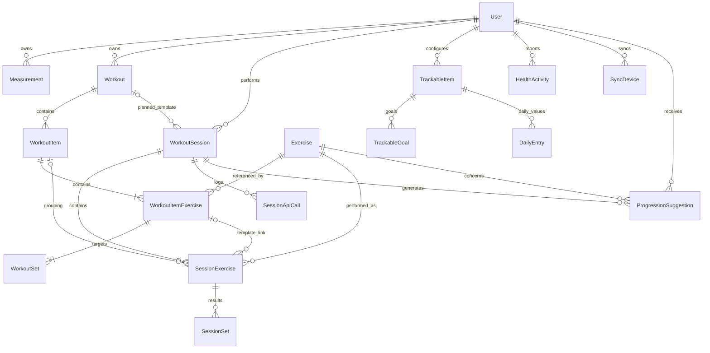

# Momentum — Data Models

## 1. Scope and sources of truth

Reconciled against repository sources on 2026-10-11. This document covers all **17 persisted
models**, their relationships, units, constraints and API representations. It supersedes the
data-model and database portions of the [archived architecture](../archive/architecture-original.md)
(sections 4, 8 and the domain glossary in 18). The archive describes earlier designs, not the runtime.

- [Prisma schema](../../apps/api/prisma/schema.prisma): fields, enums and ORM relations.
- [SQL migrations](../../apps/api/prisma/migrations): actual DDL, including constraints absent from
  the Prisma schema. This is a repository audit, not a live database introspection.
- [Prisma configuration](../../apps/api/prisma.config.ts) and
  [client singleton](../../apps/api/src/lib/prisma.ts): PostgreSQL, `pg` pool and `PrismaPg` adapter;
  `DATABASE_URL` is configured outside the datasource block. Generator: `prisma-client`, output
  `../src/generated/prisma`, CommonJS module format.
- [Shared types](../../packages/shared/src/types/index.ts) and
  [API specification](api-spec.md): transport contracts must not be inferred from old interfaces.

### Conventions

- Every model has `id: String @id @default(uuid())`. IDs are UUID strings stored as PostgreSQL
  text, not native `@db.Uuid` columns. Tables and mapped columns use snake_case; API keys use camelCase.
- Below, `?` means **nullable in persistence**, not merely omitted from a request. Unmarked fields
  are required. `String`, `Int`, `Float`, `Boolean` and `DateTime` are Prisma scalar types.
- `createdAt` defaults to `now()` wherever listed; `updatedAt` uses `@updatedAt` wherever listed.
  Other defaults are stated explicitly. Relations are not scalar columns in JSON unless included.
- Only `User.birthDate`, `Measurement.date`, `DailyEntry.date` and `HealthActivity.date` have
  `@db.Date`. Other dates are timestamps (migration DDL uses `TIMESTAMP(3)`, without a declared
  database timezone). Prisma returns JavaScript `Date`; JSON serializes dates to ISO strings.
- `YYYY-MM-DD` is the entry/activity calendar key; it is distinct from creation/correction time.
  Request validation and timezone handling differ by domain; see [API date semantics](api-spec.md#7-daily-tracking).
- Persistence has no general positivity/range checks. Zod bounds apply only to their specific
  routes. Positions and set numbers have ordering indexes, **not uniqueness constraints**.

## 2. Relationships

The diagram's nonempty template children reflect API creation rules; foreign keys alone do not
require a parent to have children. `substitutedFromId` is a nullable text marker, **not a self-FK**.
There is no `Streak`, `Set` or `WorkoutExercise` model.

## 3. Identity and measurements

### User → `users`

<!-- prettier-ignore -->
| Fields | Type / meaning |
| --- | --- |
| `email`, `passwordHash`, `name` | String; email unique; bcrypt hash is private |
| `birthDate` | DateTime? / DATE; date of birth, not an age field |
| `height` | Float? / centimetres |
| `goalDescription` | String? |
| `accentColor` | String, default `#FAFAFA`; preference endpoint validates six-digit hex and uppercases it |
| `passwordResetToken` | String?; SHA-256 digest of a reset token, never its plaintext |
| `passwordResetExpiresAt` | DateTime?; reset service grants one hour |
| `createdAt`, `updatedAt` | DateTime |

Owns measurements, workouts, sessions, progression suggestions, health activities, sync devices
and trackables. There is no exercise ownership relation. Password/reset fields are excluded from
user-facing selects. [Auth/reset implementation](../../apps/api/src/services/password-reset.service.ts).
Profile, login, registration and `/auth/me` expose different user projections; they are not a
single complete `User` DTO. Accent is returned by auth/preferences, not the base profile endpoint.

### Measurement → `measurements`

`userId: String` references User; `date: DateTime @db.Date`. All numeric fields are `Float?`:

<!-- prettier-ignore -->
| Unit | Fields |
| --- | --- |
| kg | `weight` |
| cm, upper body | `neck`, `shoulders`, `chest` |
| cm, bilateral arms | `bicepsLeft`, `bicepsRight`, `forearmLeft`, `forearmRight`, `wristLeft`, `wristRight` |
| cm, core | `waist`, `hips` |
| cm, bilateral legs | `thighLeft`, `thighRight`, `calfLeft`, `calfRight`, `ankleLeft`, `ankleRight` |

Also `notes: String?`, `createdAt: DateTime`; no `updatedAt`. Unique `(userId, date)` means one
record per user/day. Missing measurements remain null; partial updates preserve omitted fields
and explicit null clears them. At least one numeric measurement is **not** required by the schema.
[Measurement validation](../../apps/api/src/schemas/measurement.schema.ts).

## 4. Shared exercise library and workout templates

### Exercise → `exercises`

`name: String`, `muscleGroups: String[]`, `createdAt: DateTime`. Relations to template exercises,
session exercises and progression suggestions. No `userId`, `isCustom`, name uniqueness or
muscle-array index. Every authenticated user can create/update/delete shared library entries,
subject to references; it is not a private custom-exercise library.

The application muscle vocabulary is `abdos`, `biceps`, `dos`, `epaules`, `fessiers`, `ischios`,
`lombaires`, `mollets`, `pecs`, `quadriceps`, `trapezes`, `triceps`. It is a shared TS constant and
Zod enum, **not** a PostgreSQL enum. Direct SQL can store other strings.
[Exercise routes](../../apps/api/src/routes/exercise.routes.ts).

### Workout → `workouts`

`userId: String` → User; `name: String`, `description: String?`, `createdAt`, `updatedAt: DateTime`.
Has `items: WorkoutItem[]` and `sessions: WorkoutSession[]`. No user lookup index beyond the PK.
List responses additionally derive `lastCompletedAt`; it is not a column.

### WorkoutItem → `workout_items`

`workoutId: String` → Workout; `type: String` (`exercise`/`superset` validated by API),
`position: Int` (API ≥1), `rounds: Int` (DB default 1), `restAfter: Int` (seconds).
Has template exercises and session-exercise grouping links. Index `(workoutId, position)`.
API requires exactly one exercise for `exercise`, at least two for `superset`; it does not require
`rounds=1` for a simple item. Rounds/grouping metadata are not separate persisted round entities.

### WorkoutItemExercise → `workout_item_exercises`

`workoutItemId: String` → WorkoutItem; `exerciseId: String` → Exercise; `position: Int` (API ≥1),
`restBetweenSets: Int` (seconds). Has `sets: WorkoutSet[]` and session-exercise links.
Index `(workoutItemId, position)`.

### WorkoutSet → `workout_sets`

`workoutItemExerciseId: String` → WorkoutItemExercise; `setNumber: Int`, `targetReps: Int`,
`targetWeight: Float?` (kg). Index `(workoutItemExerciseId, setNumber)`.
Null weight means no specified load; zero is a valid target. Do not replace null with zero in all
domains. [Workout validation](../../apps/api/src/schemas/workout.schema.ts) and
[nested transactional writes](../../apps/api/src/routes/workout.routes.ts).

## 5. Session execution, results and progression

### WorkoutSession → `workout_sessions`

`userId: String` → User; `workoutId: String?` → Workout; `type: SessionType` default `planned`;
`status: SessionStatus` default `in_progress`; `startedAt: DateTime` default `now()`;
`completedAt: DateTime?`; `notes: String?`. Has exercises, suggestions and API-call logs.
No `createdAt`/`updatedAt`; `completedAt` is also set when abandoned.

- Planned start copies ordered template exercises and set targets; session positions start at 0.
- Ad-hoc start has no workout; template/grouping links on its exercises are null. Targets come from
  the user's last eligible completed performance for each exercise, or three sets of 10 reps at
  0 kg. It can append exercises while active; duplicates are rejected in that operation.
- Targets/results are persisted independently of later template edits. Rest/grouping metadata
  remain linked rather than fully snapshotted; replacing template items can clear those links.
- Session start/end use execution time; there is no API payload for backdating them.

### SessionExercise → `session_exercises`

`sessionId: String` → WorkoutSession; `exerciseId: String` → Exercise;
`workoutItemExerciseId: String?` → WorkoutItemExercise; `workoutItemId: String?` → WorkoutItem;
`status: SessionExerciseStatus` default `pending`; `position: Int`;
`substitutedFromId: String?` (original **SessionExercise ID**, no FK). Has SessionSet children.
Index `(sessionId, position)`. Substitution preserves the original row as `substituted`, copies
targets into a new row, and does not copy actual results.

### SessionSet → `session_sets`

`sessionExerciseId: String` → SessionExercise; `setNumber: Int`; `targetReps: Int`;
`targetWeight: Float?` (kg); `actualReps: Int?`; `actualWeight: Float?` (kg); `rpe: Int?` (1–10
on API writes); `completedAt: DateTime?`. Index `(sessionExerciseId, setNumber)`.
Recording results updates an existing target set and stamps completion. A nullable result is
unrecorded, not automatically zero. Result updates do not refresh `completedAt`.

### SessionApiCall → `session_api_calls`

`sessionId: String` → WorkoutSession; `method`, `path: String`; `statusCode`, `durationMs: Int?`;
`createdAt: DateTime`. Index `(sessionId)`. Path includes the original URL/query. Logging is
best-effort for wrapped session routes, not a complete API audit trail; no request body is stored.
[Session execution and logging](../../apps/api/src/routes/session.routes.ts).

### ProgressionSuggestion → `progression_suggestions`

`userId: String` → User; `exerciseId: String` → Exercise; `sessionId: String` → WorkoutSession;
`suggestionType: SuggestionType`; `currentValue`, `suggestedValue: Float`; `reason: String`;
`status: SuggestionStatus` default `pending`; `createdAt: DateTime`; `respondedAt: DateTime?`.
Unique `(sessionId, exerciseId)`; index `(userId, exerciseId)`.

The [progression service](../../apps/api/src/services/progression.service.ts) currently stores
**increments** with `currentValue=0`: +5 kg compound, +2.5 kg isolation, or +2 reps for no-load
targets. Acceptance increments each linked template set; a repeated response to an already
answered suggestion is idempotent. Suggestions are generated lazily by reads, not automatically
by session completion. Ad-hoc/abandoned sessions generate none. No `increase_sets` value exists.
AI coaching proposals are transient DTOs, not an eighteenth table.

### Persisted enums (complete)

<!-- prettier-ignore -->
| Enum | Values |
| --- | --- |
| `SessionStatus` | `in_progress`, `completed`, `abandoned` |
| `SessionType` | `planned`, `ad_hoc` |
| `SessionExerciseStatus` | `pending`, `in_progress`, `completed`, `skipped`, `substituted` |
| `TrackingType` | `boolean`, `number`, `duration` |
| `GoalFrequency` | `daily`, `weekly`, `monthly` |
| `SuggestionType` | `increase_weight`, `increase_reps` |
| `SuggestionStatus` | `pending`, `accepted`, `dismissed` |

## 6. Daily tracking and Health Connect

### TrackableItem → `trackable_items`

`userId: String` → User; `name`, `icon`, `color: String`; `trackingType: TrackingType`;
`unit: String?`; `isSystem: Boolean` default false; `isActive: Boolean` default true;
`sortOrder: Int` default 0; `createdAt`, `updatedAt: DateTime`. Has goals and daily entries.
Index `(userId)` only; names and sort orders are not unique. Custom creation appends after the
last custom sort order, starting at 100. Icons are nonempty strings on CRUD; only AI suggestions
are filtered against [known icon names](../../apps/api/src/data/valid-icons.ts).

### TrackableGoal → `trackable_goals`

`trackableId: String` → TrackableItem; `targetValue: Float`; `frequency: GoalFrequency`;
`startDate: DateTime` default `now()`; `endDate: DateTime?`; `createdAt`, `updatedAt: DateTime`.
These are timestamps, not DATE columns. No secondary index or unique active-goal constraint.
Creating a goal closes existing `endDate=null` goals in a transaction. Reads select one active
goal without ordering and do not reconstruct a historical configuration from `startDate`.

### DailyEntry → `daily_entries`

`trackableId: String` → TrackableItem; `date: DateTime @db.Date`; `value: Float`;
`notes: String?`; `source: String` default `manual`; `createdAt`, `updatedAt: DateTime`.
Unique `(trackableId, date)`. Source conventions: `manual` and `health_connect` (not DB enums).
Boolean convention is 0/1, duration is minutes, numeric units come from the trackable. The manual
entry endpoint only validates `value` as a number: it does not enforce boolean 0/1, nonnegativity,
current activation, system-item restrictions or goal-related limits.

Manual upsert/delete verify ownership through the trackable and reject existing Health Connect
entries. Sync may overwrite manual values for its system trackables. These checks are not a
database source-priority constraint. [Tracking service](../../apps/api/src/services/tracking.service.ts).

### HealthActivity → `health_activities`

`userId: String` → User; `date: DateTime @db.Date`; `startTime`, `endTime: DateTime`;
`activityType: String`; `title: String?`; `durationMinutes: Float` (minutes);
`calories: Float?` (kcal); `distance: Float?` (metres); `heartRateAvg: Int?` (bpm);
`sourceApp: String?` (package name); `hcRecordId: String?`; `createdAt`, `updatedAt: DateTime`.
Unique `(userId, hcRecordId)`; index `(userId, date)`. Sync requires a nonempty record ID (not
necessarily a UUID); persistence remains nullable. PostgreSQL permits multiple null record IDs.
Imported activities are not WorkoutSession rows and do not increment computed workout counts.

### SyncDevice → `sync_devices`

`userId: String` → User; `deviceName: String`; `lastSyncAt: DateTime`; `createdAt: DateTime`.
Index `(userId)`; no `(userId, deviceName)` uniqueness. Sync performs find/update-or-create by
that pair, so concurrent first syncs can create duplicate devices.

### System definitions and import semantics

<!-- prettier-ignore -->
| Name (lookup key) | Type / unit | Default goal |
| --- | --- | --- |
| `Pas` | number / pas | 10,000 daily |
| `Minutes d'activite` | duration / min | 90 daily |
| `Calories actives` | number / kcal | 500 daily |
| `Durée sommeil` | duration / min | 480 daily |
| `Séances de sport` | number / séances | 3 weekly |

[Health sync routes](../../apps/api/src/routes/health-sync.routes.ts) lazily create these per user.
Sleep payload stages, score and start/end times are accepted/validated but **not persisted**;
only duration/day is saved as a DailyEntry. Multiple sleep records for the same day overwrite
in batch order rather than aggregate. Null daily metrics are skipped, not cleared. Workout
counts are computed from completed WorkoutSession rows by `completedAt`, across both session types.
[Trackable listing](../../apps/api/src/routes/trackable.routes.ts) can also lazily create workout
configuration and a missing sleep goal; listing is not guaranteed read-only.

## 7. Constraints, indexes and deletion behavior

All primary keys and the following unique/secondary indexes are present; do not assume the
archive's additional indexes are deployed.

<!-- prettier-ignore -->
| Table | Unique (besides PK) | Secondary indexes |
| --- | --- | --- |
| `users` | `email` | none |
| `measurements` | `(userId, date)` | none |
| `exercises`, `workouts` | none | none |
| `workout_items` | none | `(workoutId, position)` |
| `workout_item_exercises` | none | `(workoutItemId, position)` |
| `workout_sets` | none | `(workoutItemExerciseId, setNumber)` |
| `workout_sessions` | partial `(userId)` where status=`in_progress` | `(userId, status)`, `(workoutId)` |
| `session_exercises` | none | `(sessionId, position)` |
| `session_sets` | none | `(sessionExerciseId, setNumber)` |
| `session_api_calls` | none | `(sessionId)` |
| `progression_suggestions` | `(sessionId, exerciseId)` | `(userId, exerciseId)` |
| `trackable_items` | none | `(userId)` |
| `trackable_goals` | none | none |
| `daily_entries` | `(trackableId, date)` | none |
| `health_activities` | `(userId, hcRecordId)` | `(userId, date)` |
| `sync_devices` | none | `(userId)` |

The [preferences/ad-hoc migration](../../apps/api/prisma/migrations/20260731120000_add_preferences_and_ad_hoc_sessions/migration.sql)
adds two SQL-only invariants:

1. `workout_sessions_type_workout_check`: planned requires nonnull workout ID; ad-hoc requires null.
2. `workout_sessions_one_in_progress_per_user`: at most one active session per user. The migration
   abandons older concurrent active sessions, keeping the newest by `startedAt`, then ID.

The migration makes `workout_id` nullable but retains its earlier `ON DELETE RESTRICT` FK.
The optional relation in the current Prisma schema has no explicit action, so schema-derived
default behavior can differ from the migration-defined database. Preserve migration invariants
when evaluating schema changes or `db push`.

<!-- prettier-ignore -->
| Parent deletion | Migration-defined action |
| --- | --- |
| User → Measurement, Workout, WorkoutSession, ProgressionSuggestion, TrackableItem, HealthActivity, SyncDevice | RESTRICT |
| Workout → WorkoutSession | RESTRICT (including existing planned history) |
| Workout → WorkoutItem → WorkoutItemExercise → WorkoutSet | CASCADE down template children |
| WorkoutItem / WorkoutItemExercise → SessionExercise template links | SET NULL |
| Exercise → WorkoutItemExercise, SessionExercise, ProgressionSuggestion | RESTRICT |
| WorkoutSession → SessionExercise → SessionSet | CASCADE |
| WorkoutSession → ProgressionSuggestion / SessionApiCall | CASCADE |
| TrackableItem → TrackableGoal / DailyEntry | CASCADE |

Migration FKs use `ON UPDATE CASCADE`. There is no universal cascade on account deletion, no
account-delete endpoint and no DB ownership equality constraint across user/session/suggestion.
Route/service checks enforce access boundaries; foreign keys only enforce referenced existence.

## 8. Type boundaries and remaining discrepancies

The shared package currently exports only `User`, `ApiResponse<T>`, `HealthCheckResponse`,
`MUSCLE_GROUPS`, `MuscleGroup` and `Exercise`. It does **not** export the full historic domain
interface block, `AuthTokens`, workout/session/tracking models or Streak.

- Shared User/Exercise dates are typed as `Date`, although JSON contains strings; client DTOs
  generally use strings. Shared `ApiResponse<T>` (`success/data/error?: string`) is not the standard
  actual route envelope (`error: {code,message,...}` or route-specific success bodies).
- [Session DTOs](../../apps/web/src/lib/api/sessions.ts) correctly allow nullable workout/template
  relations. [Tracking DTOs](../../apps/web/src/lib/api/tracking.ts) declare ring/sleep `trackableId`
  as string, while missing system items produce null. Sleep percentage is numeric in the service.
- Superset replacement writes `basePosition + i * 0.001` into an Int field before reordering;
  this is an implementation/schema inconsistency requiring runtime confirmation, not a valid
  fractional-position model.
- Progression's compound list uses `pectoraux`, whereas the supported muscle key is `pecs`.
  Historical-session evaluation does not explicitly exclude the current completed session;
  comments about the number of prior successful sessions do not consistently match the code.
- System lookup depends on mutable names; CRUD permits renaming system items. There is no unique
  system-key or active-goal constraint, so concurrent lazy creation needs separate consideration.

### Story 3.8 date behavior

Existing DATE keys and unique entries support retroactive correction without new tables. Current
active habits/goals, not versioned snapshots, remain the configuration model. The home passes
selected-day context to its existing tracking aggregate: entries use the selected activity-date
key, weekly/monthly progress is capped at that key, and workout counts use `completedAt` with
browser-local timestamp bounds. `createdAt` is not an accomplishment date. Requests without
context retain the legacy aggregate behavior; other tracking endpoints are not changed. See the
[API contract](api-spec.md#7-daily-tracking).

## 9. Historical reconciliation and glossary

<!-- prettier-ignore -->
| Archived design | Current resolution |
| --- | --- |
| CUID IDs, `prisma-client-js`, datasource URL in schema (§8) | UUID text IDs, `prisma-client`, adapter/configuration files |
| Private/custom Exercise with user ownership (§4/8) | Shared library; fields/relation explicitly removed by migration |
| Flat `WorkoutExercise`, `order`, `targetSets` (§4/8) | Ordered item/exercise/set hierarchy; superset-capable targets per set |
| Flat session `Set` and mandatory workout (§4/8) | SessionExercise/SessionSet, nullable workout plus SQL type invariant |
| `increase_sets`, absolute suggestion values (§4/8) | Two persisted suggestion types; current generator stores increments |
| Persisted Streak and streak indexes (§4/8) | Not implemented; retained only as a historical product concept |
| Goal start/end DATE and blanket user cascades (§8) | Timestamp goal dates and migration-specific deletion rules |
| Full shared domain interfaces (§4) | Minimal shared exports; route/client-local DTOs |

Obsolete schema/interface listings and their nonexistent indexes are intentionally not copied
as active definitions. The archive retains them for provenance; all their current domains are
covered above. Health Connect, reset credentials, API logs, accent and ad-hoc execution supplement
the original design. Frontend/deployment references from §18 belong in their respective shards.

<!-- prettier-ignore -->
| Term | Current meaning |
| --- | --- |
| Workout | Reusable ordered template of items, exercises and per-set targets |
| WorkoutItem / Superset | Single-exercise or multi-exercise template container with rounds/rest metadata |
| Session | Actual planned or ad-hoc execution with separately persisted targets/results |
| Set | One numbered target/result row; training volume is reps × kg, not a table named Set |
| Trackable | User-owned configured habit/metric, custom or system |
| Streak | Consecutive goal-achieving periods; historical concept, no current persistence/API |
| Progressive overload | Incrementing training stimulus, currently reps or weight |
| RPE | Integer rate of perceived exertion, 1–10 on result input |

Useful external references: [Prisma schema](https://www.prisma.io/docs/orm/prisma-schema),
[referential actions](https://www.prisma.io/docs/orm/prisma-schema/data-model/relations/referential-actions),
[PostgreSQL constraints](https://www.postgresql.org/docs/16/ddl-constraints.html),
[Health Connect data types](https://developer.android.com/health-and-fitness/guides/health-connect/data-and-data-types/data-types).
