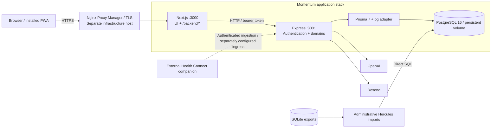

# Momentum — Architecture Overview

> Reconciled against the repository on 2026-10-11. Replaces sections 1–2 of the
> original architecture. This is an existing application, not a greenfield plan.

## 1. Purpose and Scope

Momentum is a self-hosted fitness and daily-tracking application: workout
templates, planned and ad-hoc sessions, recorded performance, progression,
measurements, configurable habits, and synchronized health metrics.

Changes must preserve persistent user data and imported training history. The
original MVP and greenfield descriptions explain the project's origin; they no
longer describe its implementation stage. This overview owns system boundaries,
architectural decisions, and cross-cutting constraints. Detailed contracts,
models, implementation patterns, and procedures belong to the domain documents.

Story [3.8](../stories/3.8.daily-home-navigation.md) is implemented: the home uses browser-local
selected-day state and optional date context on its existing tracking aggregate. Story completion
records user-reported overall manual acceptance on the local development server on `code` using a
local production-data copy; it is not a production deployment or a formal code review.

## 2. Architectural Style and Boundaries

Momentum is a modular monolith with two application processes: Next.js for web
presentation and HTTP forwarding, Express for business endpoints. Backend domains
share one Express application and PostgreSQL database; they are not independently
deployed microservices. Routers, schemas, and service functions organize domains,
but a uniform controller/service/repository layering is not enforced.

| Boundary                               | Responsibility                                                             |
| -------------------------------------- | -------------------------------------------------------------------------- |
| `apps/web` — `@momentum/web`           | App Router, React UI, browser state, API clients, forwarding, web liveness |
| `apps/api` — `@momentum/api`           | REST endpoints, authentication, domain logic, Prisma and external calls    |
| `packages/shared` — `@momentum/shared` | Selected compiled types and constants; not a complete contract registry    |
| PostgreSQL 16                          | Authoritative application persistence                                      |
| Hercules scripts                       | Administrative imports outside normal authenticated HTTP paths             |

The browser does not access Prisma or PostgreSQL. Shared TypeScript declarations
do not validate JSON; API schemas and handlers are the runtime validation boundary.

## 3. System Context

Web clients call `/backend`; the catch-all forwarding route sends requests to
server-side `API_URL` (`http://localhost:3001` by default, `http://api:3001` in
Compose). It forwards query, body, authorization, upstream status and response;
connection failure yields HTTP 502 `PROXY_ERROR`. Express mounts `/auth`,
`/sessions`, `/tracking`, and other domains directly, without `/api/v1`.

The forwarding route is distinct from Next.js `src/proxy.ts`, which redirects UI
routes based on browser authentication state. A separate API hostname is not
required for the browser. External client ingress is an operational concern.

## 4. Decisions and Rationale

The table combines retained original intent and consequences visible in the code;
it does not imply separate ADRs exist for every choice.

| Decision          | Choice and consequence                                                                                             |
| ----------------- | ------------------------------------------------------------------------------------------------------------------ |
| Monorepo          | npm workspaces: shared dependencies and sequential shared → API → web builds without Turborepo/Nx complexity       |
| Business boundary | Express outside Next.js: reusable business API for web and external clients with a small self-hosted footprint     |
| Persistence       | PostgreSQL + Prisma/pg: relational integrity and migrations; SQL can enforce constraints not represented by Prisma |
| Browser state     | Zustand, direct fetch, local component state: no React Query cache or automatic invalidation layer                 |
| Authentication    | bcrypt and stateless JWT bearer tokens: no server session store; logout does not revoke issued tokens              |
| Packaging         | Separate web/API images, Next.js standalone: separate processes, not necessarily separate hosts                    |
| UI                | Tailwind v4, shadcn/Radix, dark theme, dynamic user-accent variables                                               |
| Health ingestion  | External platform-specific collector, authenticated API, persisted provenance                                      |
| AI and email      | Server-side OpenAI/Resend: browser does not receive provider credentials; external availability and privacy matter |
| Schema evolution  | Migrations before API startup: reverting images does not reverse database migrations                               |
| Legacy migration  | Administrative direct SQL imports: explicit ownership and replay review, not runtime API functionality             |

No Redis cache, broker, or independently deployed background worker is present.
Next.js standalone remains current. React Query, centralized controller classes,
rate limiting, pino logging, and automated test suites from the original plan
must not be described as implemented controls.

## 5. Trust, Integrations, and Health

Express verifies bearer signatures and user-scoped operations enforce ownership.
The auth store persists localStorage state and mirrors a JavaScript-written
cookie for UI redirects; this is not an HttpOnly session or proof of identity.
Logout clears local state without token revocation. The same-origin proxy does
not secure a directly exposed API. Binding to `0.0.0.0` currently permits reflected
CORS origins; production secrets and exposure require operational review.

Health Connect ingestion persists metrics, sleep, activities, and device sync
metadata. Manual entry updates/deletes reject existing Health Connect entries;
sync can replace entries with synchronized provenance. Planned-workout coaching
and icon suggestions use OpenAI; applying coaching advice is separate from
generating it. Ad-hoc sessions cannot use template-based coaching. Resend handles
password-reset email. Both provider clients are imported unconditionally before
the API starts listening. With the installed SDKs, Resend rejects missing or
empty keys, and OpenAI rejects an undefined key. The example environment and
standalone Compose template therefore cannot be assumed to start the API without
explicit provider configuration. This is an application initialization gap, not
merely disabled optional functionality; see deployment prerequisites.

Web `/api/health` checks web liveness only. API `/health` queries PostgreSQL and
returns 503 on database failure; `/backend/health` traverses both application
processes. PostgreSQL has a separate readiness check. The PWA service worker
schedules rest notifications; installation does not imply offline caching or
general offline-write synchronization.

The repository production Compose is a template, not proof of live deployment.
The homelab infrastructure repository owns the operational Compose. NPM runs on
a separate host, and Dockhand manages deployment. See [deployment.md](./deployment.md)
for verified repository procedures and explicit operational boundaries.

## 6. Incremental-Change Constraints

- Preserve ownership, stored history, and SQL-enforced invariants: one active
  session per user and planned/ad-hoc consistency.
- Treat session `workoutId` and `workout` as nullable.
- Separate calendar keys (`YYYY-MM-DD`, SQL DATE) from execution timestamps.
  Viewing a past day must not backdate a started workout.
- Preserve Health Connect provenance and manual-edit restrictions.
- Account for SSR, browser timezone, local persistence hydration, midnight,
  asynchronous response ordering, and date-scoped mutation/rollback.
- Use user-accent CSS variables for primary actions and focus states.
- Workspace-level Node tests exist for focused contracts; CI currently verifies lint/build rather
  than running those tests.

Story 3.8 is implemented by extending the existing home and `GET /tracking/today`, not by adding a
new dashboard, table, configuration snapshot, or infrastructure component. The selected calendar
key controls date entries and current week/month goal progress, with period entries capped at that
key. Completed-session counts use browser-local timestamp bounds as half-open intervals for the
selected day and through the selected day in its week/month. Existing callers without date context
retain the API-local-today behavior; separate rings, summary, and other endpoint semantics are not
changed by this contract.

The product owner confirmed browser-local calendar authority for Story 3.8: initial today, future
cap, explicit DATE keys, and timestamp-counter day bounds agree with the browser calendar.
Selected-day and period starts are serialized as UTC instants for timestamp queries; the day uses
an exclusive next-local-day cutoff, and week/month queries end at that same exclusive cutoff.
Calendar arithmetic handles DST without adding fixed 24-hour days. The browser refreshes today's
cap at local midnight and on focus/visibility resume without retargeting the selected day or an
open editor/pending mutation. See the [API contract](api-spec.md#7-daily-tracking) and
[frontend behavior](frontend-architecture.md#5-browser-lifecycle-visual-preferences-and-dates).

## 7. Source References

- [Root workspace and scripts](../../package.json), [shared declarations](../../packages/shared/src/types/index.ts).
- [Express bootstrap](../../apps/api/src/index.ts), [Prisma singleton](../../apps/api/src/lib/prisma.ts).
- [HTTP forwarding route](../../apps/web/src/app/backend/[...path]/route.ts), [UI proxy](../../apps/web/src/proxy.ts).
- [Auth store](../../apps/web/src/stores/auth.ts), [auth service](../../apps/api/src/services/auth.service.ts).
- [Next.js configuration](../../apps/web/next.config.mjs), [API image](../../docker/Dockerfile.api).
- [Tracking aggregation](../../apps/api/src/services/tracking.service.ts), [Health sync](../../apps/api/src/routes/health-sync.routes.ts).
- [SQL invariants](../../apps/api/prisma/migrations/20260731120000_add_preferences_and_ad_hoc_sessions/migration.sql).
- [CI](../../.github/workflows/ci-cd.yml), [service worker](../../apps/web/public/sw.js).
